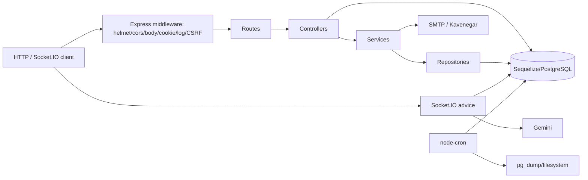

# معماری، راه‌اندازی و وابستگی‌ها

## شناسنامه

- نام package: `lamora_project` نسخه `1.0.0`؛ مستند Swagger نسخه API را `1.6.2` اعلام می‌کند (`package.json:2-4`, `src/config/swagger.js:6-10`).
- زبان: JavaScript CommonJS روی Node.js؛ HTML تستی برای Socket.IO.
- HTTP: Express 5.1.0 (قفل 5.1.0)، Socket.IO 4.8.1.
- DB/ORM: PostgreSQL (`pg` 8.16.3)، Sequelize 6.37.7 و sequelize-cli 6.6.3.
- امنیت/هویت: JWT، bcrypt، Helmet، CORS، csurf، cookie-parser و rate limit.
- فایل/گزارش: multer، ExcelJS، csv-parse، csv-writer.
- بیرونی: Google Gemini، Kavenegar SMS، Nodemailer SMTP؛ پرداخت زرین‌پال فقط شبیه‌سازی شده است.

نسخه‌های `package.json` عمدتاً range با `^` هستند؛ نسخه‌های بالا از lockfile v3 آمده‌اند. نمونهٔ تفاوت: `multer ^2.0.1` به `2.0.2` قفل شده است. Node engine اعلام نشده و دستور start نیز تعریف نشده (`package.json:5-10`).

## راه‌اندازی واقعی

ورودی اصلی عملی `node server.js` است، هرچند `package.json.main` به `index.js` ناموجود اشاره می‌کند. `server.js` dotenv را بار می‌کند، مدل‌ها را به‌صورت پویا از `src/models` می‌خواند، middlewareها و routeها را mount می‌کند، Socket.IO را وصل می‌کند و پس از listen دو scheduler را شروع می‌کند (`server.js:1-52,65-159,165-310`, `models/index.js:10-42`).

ورودی مستقل توسعه‌ای `node start_frontend_dev.js` کل ریشهٔ پروژه را روی پورت 3001 static serve می‌کند؛ این کار بالقوه فایل‌های کد/backup/log را نیز در معرض HTTP محلی می‌گذارد (`start_frontend_dev.js:1-14`). `ws_test.html` کلاینت تست AI است و `userId=1` را ثابت می‌فرستد (`ws_test.html:111-164`).

## متغیرهای محیطی

| نام | کاربرد |
|---|---|
| `NODE_ENV`, `PORT`, `CORS_ORIGIN` | محیط، پورت، origin مجاز |
| `DB_USER`, `DB_PASSWORD`, `DB_HOST`, `DB_PORT` | اتصال PostgreSQL |
| `DB_NAME_DEV`, `DB_NAME_TEST`, `DB_NAME_PROD` | DB هر محیط |
| `JWT_SECRET`, `JWT_EXPIRES_IN` | access token |
| `JWT_REFRESH_SECRET`, `JWT_REFRESH_EXPIRES_IN` | refresh token؛ endpoint مصرف ندارد |
| `FRONTEND_RESET_PASSWORD_URL` | لینک reset ایمیل |
| `OTP_EXPIRES_IN_MINUTES` | اعتبار OTP/SMS |
| `EMAIL_HOST`, `EMAIL_PORT`, `EMAIL_SECURE`, `EMAIL_USER`, `EMAIL_PASS`, `EMAIL_USERNAME` | SMTP |
| `SMS_API_KEY`, `SMS_SENDER_NUMBER` | Kavenegar |
| `GEMINI_API_KEY` | AI؛ نبود آن هنگام require باعث توقف startup می‌شود |
| `DB_BACKUP_PATH`, `DB_BACKUP_RETENTION_DAYS` | محل و retention بکاپ |

همچنین proxy به‌صورت ثابت به `http://127.0.0.1:10809` در startup تحمیل می‌شود (`server.js:16-18`). مقدار هیچ secret در این گزارش ثبت نشده است.

## مسیر اجرا

معماری یکدست نیست: کاربران/محصول/سبد/سفارش/کوپن عمدتاً Controller→Service→Repository دارند، اما payment، shipping، review، search، campaign، settings، AI، admin import/export و jobها مستقیماً مدل‌ها را مصرف می‌کنند. منطق دامنه در service، controller و utility پراکنده است.

## ورودی‌ها و پردازش‌های مستقل

- HTTP: ۱۰۶ route declaration در ۱۸ فایل route؛ `onlineShoppingAdviceRoutes` با ۴ route mount نشده است.
- Socket.IO: event ورودی `sendAdviceMessage` و خروجی `receiveAdviceMessage` (`server.js:165-263`).
- Scheduler: بکاپ روزانه ساعت 00:00 و cleanup سفارش هر ساعت (`src/utils/backupService.js:73-89`, `src/utils/orderCleanupService.js:89-97`). timezone صریح نشده و به timezone process وابسته است.
- اسکریپت frontend test: `start_frontend_dev.js`.
- Migration: ۳۹ فایل؛ Seeder: ۴ فایل.

## Middleware و امنیت مسیر

ترتیب global: Helmet→CORS→body parsers→cookie→session cookie→request logger→routeهای انتخابی CSRF→error logger/handler (`server.js:72-159,274-300`). CSRF فقط روی categories/products/cart/orders/admin/reviews/coupons اعمال شده؛ payments/settings/shipping/brands/campaigns/attributes/variants بدون CSRF global هستند. userRoutes یک instance جدا از csurf دارد (`src/routes/userRoutes.js:1-8`).

`authenticateToken` optional است: نبود token مساوی `next()` است، نه 401 (`src/middlewares/authMiddleware.js:10-17`). فقط ترکیب آن با `authorizeRoles` دسترسی را واقعاً رد می‌کند. `authenticateForPayments` اجباری است (`src/middlewares/authMiddleware.js:80-99`).

## ذخیره‌سازی و مدل‌سازی

`models/index.js` تمام فایل‌های `src/models/*.js` را پویا load و associationها را فعال می‌کند. هیچ `sequelize.sync` وجود ندارد؛ schema به اجرای migration وابسته است. مدل‌ها status را عموماً STRING آزاد نگه می‌دارند و enum/check DB ندارند. soft-delete/paranoid در هیچ مدل فعال نیست؛ حذف‌ها سخت هستند.

## اختلاف مستندات

- README یک معرفی شخصی Front-end/WordPress است و پروژهٔ فروشگاهی را توضیح نمی‌دهد (`README.md:1-31`).
- Swagger server را `/api` معرفی می‌کند، ولی annotationها غالباً مسیر کامل `/api/...` دارند؛ احتمال تولید مسیر درست وجود دارد اما قراردادهای Swagger با اجرای واقعی در چند نقطه متفاوت‌اند.
- cart در Swagger «logged-in and guest» توصیف شده، اما route فقط middleware optional دارد و عملاً guest کار می‌کند؛ نام middleware گمراه‌کننده است (`src/routes/cartRoutes.js:8-12`, `src/middlewares/authMiddleware.js:8-17`).
- campaign active در مستندات عمومی است، ولی route ordering آن را می‌بلعد.

## وابستگی اجزای اصلی

- User ← Role؛ User → Address/Cart/Order/Review/Advice/OrderHistory؛ User↔Coupon.
- Category → Product و self-tree؛ Brand → Product؛ Product → ProductVariant؛ Variant↔AttributeValue←Attribute.
- Cart→CartItem→Variant؛ Order→OrderItem→Variant و Address/Coupon/Payment/History/Shipment.
- Campaign↔Product از CampaignProduct، همزمان `Product.campaign_id` نیز وجود دارد و دو منبع حقیقت می‌سازد.
- Coupon↔Product/Category/Brand/User و UserCouponUsage.

جزئیات کامل در `domain-catalog.md` است.
